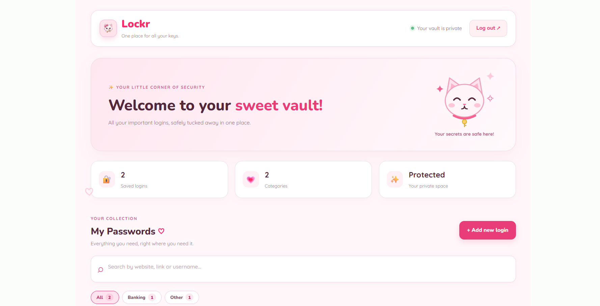
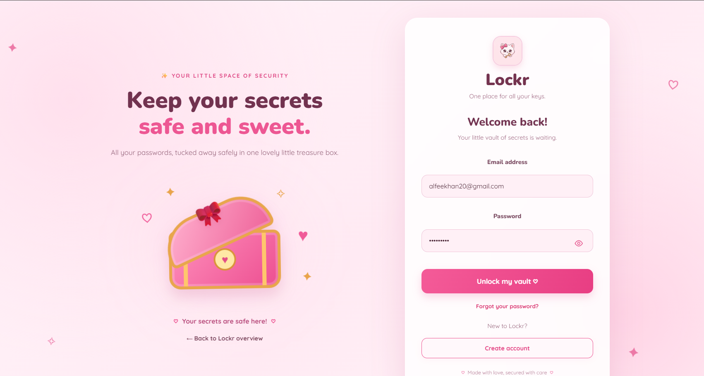
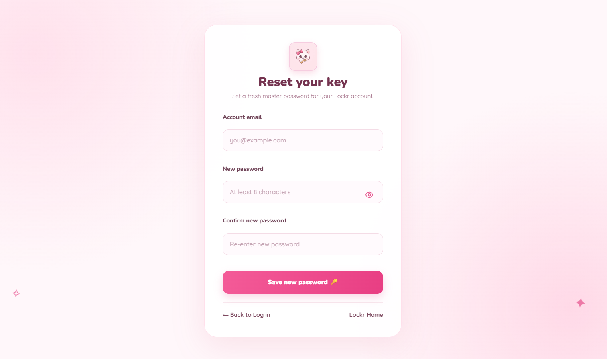

<p align="center">
  
</p>

<h1 align="center">🔐 Lockr</h1>

<p align="center">
  <strong>One place for all your keys.</strong> Lockr is a full-stack MERN password manager with encrypted storage, category filtering, instant search, and a smart generator that builds passwords to match any site's rules.
</p>

<p align="center">
  <a href="https://lockr-3k4h.vercel.app"><strong>🌐 Live Demo</strong></a>
</p>

> ⚠️ **Educational project.** Lockr has not been professionally audited. Don't use it for passwords you can't afford to lose.

---

## 📸 Screenshots

### Vault Dashboard & Category Filters
[cite: 13]

### Login & Signup Experience
[cite: 14]

### Dedicated Password Reset Page
[cite: 15]

---

## ✨ Features

- **Interactive landing & strength lab:** explore how Lockr works, filter sample vault items, and test password strength before signing in
- **Secure accounts & password reset:** sign up, log in with JWT authentication, and reset forgotten passwords via a dedicated reset flow
- **Encrypted vault:** every saved password is encrypted with AES-256-GCM
- **Edit & filter by category:** update saved entries anytime and filter your vault by category (`All`, `Banking`, `Other`, and custom categories)
- **Instant search:** find logins by site name, link, or username
- **Smart password generator:** paste a site's password rules (e.g. `"8-12 characters, one capital, one digit, symbols such as !@#"`) and get a matching password
- **Reveal and copy:** passwords stay hidden by default, auto-hide after 10 seconds, and the clipboard clears after 15 seconds
- **Per-user isolation:** every query is scoped to the logged-in user

---

## 🛠️ Tech stack

- **Frontend:** React, Vite, React Router, Axios
- **Backend:** Node.js, Express
- **Database:** MongoDB (Atlas free tier works)
- **Security:** bcrypt / bcryptjs, JWT, AES-256-GCM, Helmet, express-rate-limit

---

## 🚀 Getting started

### Prerequisites

- Node.js 18+
- A MongoDB database (local or a free [MongoDB Atlas](https://www.mongodb.com/atlas) cluster)

### 1. Clone the repo

```bash
git clone [https://github.com/Alfee123-web/Lockr.git](https://github.com/Alfee123-web/Lockr.git)
cd Lockr